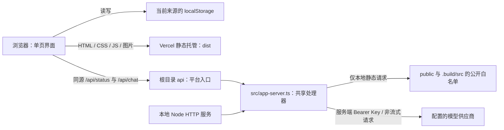
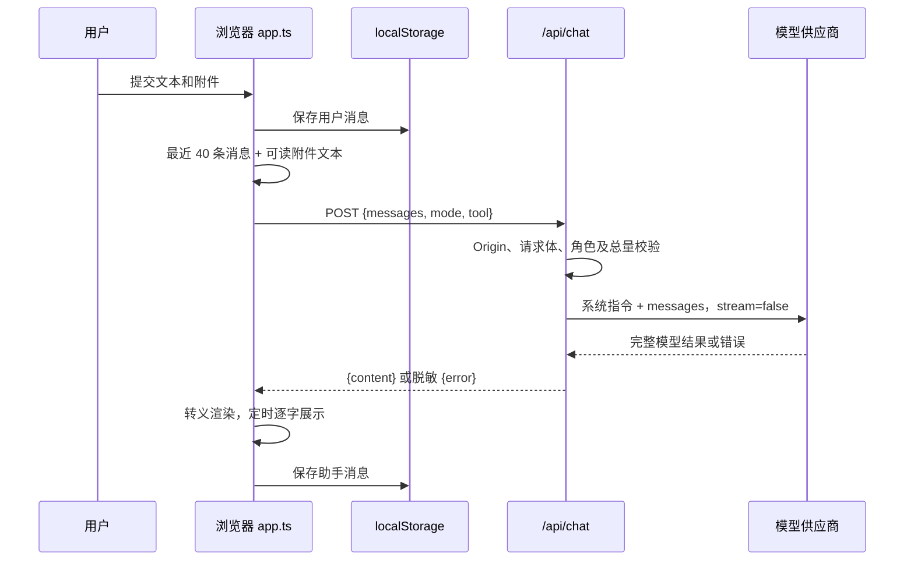

# 架构实现文档

本文以当前仓库源码为依据，记录已经实现的结构、运行流程与限制。版本发布范围、线上记录与更新方式见 [DEPLOYMENT.md](DEPLOYMENT.md)。

## 1. 组织形式判断

当前结构能够支撑小型原型：浏览器交互、HTTP 服务、共享函数和 Vercel 入口已经分开，严格类型检查、测试、锁定依赖与环境变量隔离也已具备。目前只有三个业务源码模块，保留在 `src/` 同一级。前端集中处理单页交互，服务端集中处理两个接口；当前规模无需引入框架、工作区包、依赖注入或空的 controller/service/repository 层。后续模块实际增长时再按功能拆分。

## 2. 目录与职责

```text
my-qwen/
├── src/
│   ├── app.ts                 # 浏览器入口、界面状态、事件与本地记录
│   ├── chat.ts                # 共享消息类型、校验与浏览器安全渲染
│   └── app-server.ts          # HTTP 处理器、模型代理、本地服务入口
├── api/
│   ├── chat.ts                # Vercel /api/chat 适配入口
│   └── status.ts              # Vercel /api/status 适配入口
├── public/
│   ├── index.html             # 页面结构，仍加载 /app.js
│   ├── styles.css             # 布局、主题与响应式样式
│   └── assets/                # 品牌图形与轮播图片
├── scripts/
│   ├── build.ts               # 整理浏览器公开产物
│   ├── dev.ts                 # 编译监听与 Node 自动重启
│   └── check-api.ts           # 手动调用真实服务的诊断脚本
├── tests/
│   ├── chat.test.ts           # 渲染、校验、HTTP、代理与构建回归
│   └── fixtures/sample.txt    # 手动附件测试样本
├── docs/
│   ├── ARCHITECTURE.md        # 当前实现
│   ├── DEPLOYMENT.md          # 已发布版本记录与部署步骤
│   ├── IMPLEMENTATION_PLAN.md # 暂停中的后续方案
│   └── preview.jpg            # 界面参考截图
├── .env.example              # 无密钥的配置模板
├── .gitignore
├── .vercelignore
├── package.json
├── package-lock.json
├── tsconfig.json
├── vercel.json
└── README.md
```

`.build/` 是编译中间目录，保留源目录层级；`dist/` 是浏览器发布目录，只包含 `index.html`、`styles.css`、`app.js`、`chat.js` 和 `assets/`。两者均不提交 Git。`.cache/` 保存本机临时验证和 CLI 数据，`.vercel/` 保存本机平台关联信息，也不提交或作为公开资源发布。

| 模块 | 主要入口 | 职责与依赖 |
| --- | --- | --- |
| [app.ts](../src/app.ts) | 页面加载后注册事件 | 依赖 DOM、浏览器 API、`chat.ts`；调用同源 HTTP 接口 |
| [chat.ts](../src/chat.ts) | `ChatMessage`、`validateMessages`、`renderMessage`、`formatSize` | 无环境依赖，不读取密钥；浏览器和服务器可共同引用 |
| [app-server.ts](../src/app-server.ts) | `createAppHandler`、`createAppServer`、`resolvePublicPath` | 依赖 Node 内置模块、`chat.ts` 与原生 `fetch`；读取服务端配置 |
| [api/chat.ts](../api/chat.ts)、[api/status.ts](../api/status.ts) | 默认导出的 HTTP 处理器 | 只适配 Vercel，复用同一个处理器，不复制模型调用逻辑 |
| [build.ts](../scripts/build.ts)、[dev.ts](../scripts/dev.ts) | 编译后由 npm 命令启动 | 管理公开产物与开发进程，不参与浏览器业务 |

依赖方向为浏览器/服务器分别依赖共享模块，平台入口依赖服务器。浏览器不能导入服务器模块；服务器不依赖页面交互代码。当前通过明确的 import 与构建白名单维持边界，未配置自动架构依赖检查器。

## 3. 运行架构



生产环境由 Vercel 托管静态文件，并运行两个 Node 函数；本地由一个 Node HTTP 服务同时提供页面与 API。`api/` 保留在根目录以适配现有 Vercel 自动发现约定。业务代码不绑定 Vercel SDK，也没有数据库、登录认证服务器或后台队列。

## 4. 页面状态与本地数据

`src/app.ts` 使用原生 DOM 和事件委托管理单页。日常/工作模式、菜单、弹窗、当前对话、附件、生成状态、主题及轮播均在这一模块协调。页面没有前端路由或独立的状态管理依赖。

| localStorage 键 | 数据 | 持久化边界 |
| --- | --- | --- |
| `qwen-conversations` | 会话 ID、标题、模式、时间和消息数组 | 消息可含附件名称、可读文本与工具标签 |
| `qwen-files` | 文件 ID、名称、大小、MIME 类型和日期 | 仅文件元数据，不保存原文件；写入时保留最近 100 条 |
| `qwen-projects` | 项目 ID、标题 | 当前选中项目只在内存中，尚未建立会话归属 |
| `qwen-tasks` | 任务 ID、名称、内容、计划时间 | 仅本地记录，没有后台执行或提醒 |
| `qwen-theme` | 浅色、深色或跟随系统 | 页面刷新后恢复 |

存储属于当前浏览器及网站来源，没有账户身份或跨设备同步。本次保留全部键名与数据结构，不执行数据迁移。读取时捕获 JSON 解析失败，写入失败会提示存储空间不足；当前并未对每类历史数据进行完整运行时 schema 校验。

附件处理最多接受 5 个、每个不超过 10 MB。只有 `.txt`、`.md`、`.csv`、`.json` 且大小不超过 100,000 字节的文件通过 `File.text()` 读取；其他附件保留名称并说明未解析。文件选择器仍列有 PDF、Office 和图片等类型，严格收窄白名单属于后续计划。

## 5. 一次对话的实现流程



初始化时浏览器请求 `/api/status`。配置存在时展示服务端模型名；配置缺失或检查失败时保留本地演示路径。当前状态检查没有主动调用供应商，也存在请求尚未结束时用户即可发送的竞态，不能把 `configured: true` 理解为模型可用性检查。

发送时创建或复用本地会话，截取最近 40 条已有消息，并将可读附件文本拼入相应消息。服务端只使用 `messages`；客户端携带的 `mode`、`tool` 当前不改变模型执行策略。共享系统指令由服务端添加，调用方不能直接发送 `system` 角色替换它。

上游请求返回完整文本后，浏览器每 22 ms 追加部分字符，因此当前是非流式接口加逐字显示，没有 SSE/WebSocket。停止生成会中止浏览器请求并停止显示；服务端监听连接关闭并尝试取消上游调用，不能保证供应商已经停止计费。

没有配置模型时生成明确的演示说明；配置模型且选择生图/生视频时显示暂不支持文字模型直接生成媒体的说明。其余技能、思考与研究入口尚未接入专属后端流程。

## 6. HTTP 接口与错误

### GET /api/status

返回 `200`，响应为 `{ "configured": true, "model": "模型 ID" }`；未配置 Key 时为 `{ "configured": false, "model": null }`。不返回 Key、Base URL 或认证头。响应使用 `Cache-Control: no-store`。

### POST /api/chat

请求示例：

```json
{"messages":[{"role":"user","content":"你好"}]}
```

成功响应为 `200` 和 `{ "content": "助手回复" }`；错误响应统一为 `{ "error": "可展示的中文说明" }`。参数限制由共享校验和 HTTP 边界共同执行：

| 检查 | 当前规则 |
| --- | --- |
| 请求体 | 最多 64 KiB，必须能解析为 JSON；兼容 Vercel 预解析 body |
| 消息类型 | 非空数组，每条角色只允许 `user`、`assistant`，content 必须是非空字符串 |
| 共享校验上限 | 最多 100 条，单条最多 50,000 个 JavaScript 字符串长度单位 |
| 实际 API 上限 | 最多 40 条，总内容最多 24,000 个 JavaScript 字符串长度单位 |
| 来源检查 | 带 Origin 时必须匹配 `APP_ORIGIN` 或服务端推导的当前来源 |
| 模型参数 | 服务端固定 `stream: false`、`max_tokens: 2048` |
| 上游超时 | 55 秒，生产聊天函数时限配置为 60 秒 |

前端 textarea 的长度限制是 30,000，文本附件也可能超过 API 总量限制。目前以后端校验为最终边界；统一规则属于后续计划。

| HTTP 状态 | 含义 |
| --- | --- |
| 400 | JSON 解析失败或消息格式不正确，包括平台延迟 body 解析错误 |
| 403 | 带有不匹配的 Origin |
| 413 | 请求体、消息条数或内容总量超限 |
| 429 | 上游限频或额度不足；合法数字形式的 Retry-After 会转发 |
| 502 | 上游认证失败、异常响应、连接失败、超时、无有效文本或返回 Key |
| 503 | 服务端未配置模型 Key |
| 404 / 405 / 500 | 未公开路径或文件不存在 / 不支持的方法 / 未分类服务端错误 |

上游地址固定取自服务端 `QWEN_API_BASE`，追加 `/chat/completions`，通过 `Authorization: Bearer ...` 调用。异常原文和上游错误响应不返回浏览器；成功文本若包含当前完整 Key，也会被阻止发送。

## 7. 构建、开发与部署

项目运行在 Node.js 22.x，开发依赖为 TypeScript 5.9.3 与 Node 类型定义；业务运行只使用平台和标准库。`tsconfig.json` 开启严格类型检查，采用 NodeNext / ES2022，并把 TS 相对导入扩展名重写为 JS。

```text
src/ + api/ + scripts/ + tests/ --tsc--> .build/（保留目录层级）
public/index.html + styles.css + assets/ --白名单复制--> dist/
.build/src/app.js + chat.js             --白名单复制--> dist/
api/*.ts + src/                        --Vercel 打包--> Node 函数
```

构建脚本仅清理并重新生成项目内的 `dist/`，不把整个仓库复制为静态站点。测试、文档和服务器源码不会进入浏览器产物。`.vercelignore` 排除密钥文件、本机缓存、生成目录、测试、文档和真实模型诊断脚本；函数的 `excludeFiles: ".env*"` 再排除本地环境文件。

| 命令 | 行为 |
| --- | --- |
| `npm ci` | 按 package-lock 安装构建依赖 |
| `npm run typecheck` | 严格类型检查，不生成文件 |
| `npm run build` | 编译 TS，并生成静态白名单产物 |
| `npm run dev` | 先构建，再启动 tsc 监听与 Node 监听；前端修改后刷新，服务器修改后自动重启 |
| `npm start` | 先构建，再启动本地服务，默认只监听 127.0.0.1:5173 |
| `npm test` | 先构建，再运行编译后的 Node 测试 |
| `npm run check:api` | 手动调用真实供应商，会产生模型用量，不属于自动测试 |

本地 HTTP 服务从 `public/` 读取 HTML/CSS/图片，从 `.build/src/` 读取浏览器 JS，保证开发监听编译后刷新即可生效。`/app.js`、`/chat.js`、`/styles.css`、`/assets/*` 和两个 API 地址保持不变。生产构建输出仍为 `dist/`，Vercel 函数入口及部署命令不变。

## 8. 配置与安全边界

| 环境变量 | 作用 |
| --- | --- |
| `QWEN_API_KEY` | 模型 Key，只在服务端读取；为空时未配置 |
| `QWEN_API_BASE` | OpenAI 兼容接口地址，默认 DashScope compatible-mode/v1 |
| `QWEN_MODEL` | 模型 ID，默认 qwen-plus |
| `APP_ORIGIN` | 可选，指定允许的浏览器来源；其他反向代理场景应显式配置 |
| `PORT` | 本地端口，默认 5173 |

本地服务读取项目根目录 `.env`；Vercel 使用平台注入的环境变量。模板为根目录 `.env.example`。Key 不应进入源码、Git、静态资源、错误文本或文档，生产密钥只配置在服务端环境。

本地静态处理采用文件白名单、URL 解码、目录边界和后缀限制，拒绝路径穿越与源码访问；生产只托管 `dist/`。模型/用户文本先转义再应用有限 Markdown 格式，不执行返回的 HTML。响应设置 CSP、nosniff 和 Referrer-Policy，生产静态响应由 `vercel.json` 设置同类头。

当前没有用户认证、持久化配额或接口限流。Origin 检查无法防止直接 HTTP 客户端调用，公开接口仍会消耗共享额度。已接受的共享 Key 与用量控制边界在本次保持不变。

## 9. 验证方式

`tests/chat.test.ts` 使用 Node 内置测试框架。模型代理测试连接本机模拟供应商并使用测试 Key，不访问真实共享服务。

- 安全渲染、消息角色与大小校验。
- 静态文件白名单、目录穿越防护，以及源码/文档/配置无法公开访问。
- 构建后浏览器 JS 导入可执行、只发布允许的资源、移除旧公开产物。
- HTTP 页面与资源访问、未配置模型、超长请求、非法角色和跨站请求。
- 模拟模型成功、认证错误、429 与 Retry-After、密钥回显阻止。
- Serverless 预解析请求体、HTTPS Origin 与延迟 body 解析失败。

本次目录调整已通过严格类型检查、9 项回归测试、开发监听实测及 Vercel 本地生产构建；抽查的页面、CSS、浏览器 JS 与图片和调整前逐字节一致。构建资源和函数包检查未发现实际模型 Key，函数包不含 `.env` 文件。真实共享模型验证是独立手动步骤，本次按用户偏好不执行。平台构建成功和 `/api/status` 配置正常不能证明供应商实时可用。

## 10. 当前限制与后续落点

| 能力 | 当前实现 | 后续落点（尚未执行） |
| --- | --- | --- |
| 登录 | 本地模式按钮，无真实认证 | 浏览器认证模块与服务端身份校验 |
| 思考、深度研究 | 菜单选择，普通模型代理 | 独立研究流程、搜索证据与任务状态 |
| 工作技能 / PPT | 工具标签，无服务端技能指令和文件生成 | 技能白名单与提示词组合，PPT 大纲 |
| 项目 | 本地名称列表与选择 | 会话归属、项目指令与上下文 |
| 定时任务 | localStorage 记录 | 数据库、调度器、受保护 worker |
| 附件 / 云空间 | 文本上下文与本地文件元数据 | 文本类型统一限制及“本地文件记录”命名 |
| 外部连接 / 本地助理 | 演示说明或外部链接 | 按计划统一未开放提示与外链提示 |

以上扩展实际开始时，再按职责在 `src/` 内拆出客户端和服务端功能目录；平台入口保持轻量适配，共享规则继续放入无环境依赖模块。数据库和第三方 SDK 只在对应能力落地时引入。具体方案和验收标准统一维护在 [功能实施计划](IMPLEMENTATION_PLAN.md)，本次目录调整不执行该计划。
