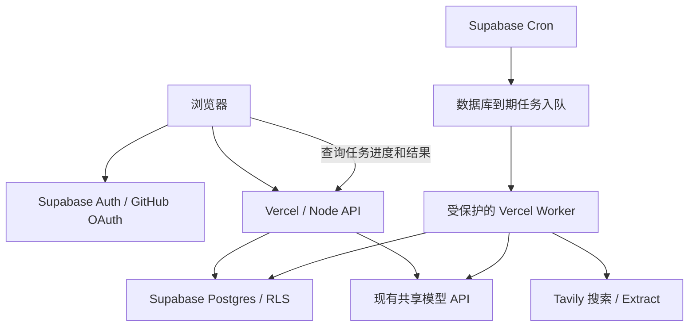

# 千问助手功能落地计划

日期：2026-10-11。状态：方案与验收计划，尚未开始本轮功能实现或线上部署。

本文描述后续功能方案，当前已实现架构以 [ARCHITECTURE.md](ARCHITECTURE.md) 为准。源码路径已随目录整理更新，不表示本计划开始执行。

已确认：首版采用 **GitHub 登录**；接受 **Supabase + Tavily**，优先使用免费额度；保留现有共享模型 Key；不建设公开接口限流/配额；不改动现有品牌身份及隐私说明。

## 1. 目标与范围

在已迁移的 React + TypeScript + webpack 前端、Node.js 22 与 Vercel 部署结构上，补全真实认证、账户数据、项目上下文、技能指令、联网研究、后台执行及线上验收。本计划继续暂停，React 迁移不表示这些功能已落地。

| 编号 | 用户要求 | 实施结果 | 验收要点 |
| --- | --- | --- | --- |
| 1 | 账号登录 | Supabase Auth 接入 GitHub OAuth，支持真实登录、恢复会话、退出 | GitHub 授权回跳成功；刷新仍登录；账号间数据隔离 |
| 2 | 思考、深度研究 | 思考采用分析/校验与最终回答两个阶段；深度研究采用搜索、阅读证据、补充检索、引用报告流程 | 后端执行路径确实不同；研究有可打开且支持结论的来源 |
| 3 | AI 生图、生视频 | 保留入口及不支持的行为，统一提示“暂不支持该行为，请等待后续开放” | 不调用模型、搜索或媒体生成接口，不生成虚假成果 |
| 4 | PPT 创作 | 所有入口改为“PPT 大纲”，配置逐页大纲技能 | 返回逐页标题、要点、讲述建议；不承诺生成 PPT 文件 |
| 5 | 工作技能 | 引入适合网页助手的 GitHub 技能指令，补齐自有技能提示词 | 选择技能实际改变服务端指令和输出结构 |
| 6 | 云空间 | 改为“本地文件记录” | 只记录本浏览器文件元数据，刷新后不会声称文件仍可读取 |
| 7 | 附件理解 | 只允许 UTF-8 文本：`.txt`、`.md`、`.csv`、`.json` | 文件选择、拖放、前后端校验一致；不支持的文件立即被拒绝 |
| 8 | 工作项目 | 会话明确归属项目，项目说明/指令/参考文本参与模型上下文 | 切换项目不串会话或上下文；刷新后归属仍在 |
| 9 | 定时任务 | 数据库存储、后台调度、执行记录、失败重试、结果回写 | 浏览器关闭后仍执行；重复触发不重复写入结果 |
| 10 | 外部应用连接 | 尝试连接后提示“暂不支持该能力，请等待后续开放” | 不出现假授权、假连接成功或不存在的同步结果 |
| 11 | 电脑端、本地工作助理 | 保持跳转千问官网，打开后在原页面提示为外部链接 | 新标签打开官网；原页面明确说明已尝试打开外部千问官网 |
| 12 | 共享 Key | 保持现状 | 不更换供应商，不增加自有 Key 或 BYOK 改造 |
| 13 | 用量控制 | 保持现状 | 不新增每用户/IP 配额、限流、积分或付费体系 |
| 14 | 身份/隐私说明 | 保持现状 | 不扩展为品牌、协议、隐私文案整改 |
| 15 | 状态与输入校验 | 修复初始化竞态、静默演示降级、状态失真、边界校验 | 断网、无配置、过期登录、超长输入、429、超时都有真实反馈 |
| 16 | 部署与线上验收 | 完成 GitHub → Vercel → Supabase/Tavily 配置和真实验收记录 | 有真实线上 URL，并完成登录、对话、研究、后台任务验收 |

首版默认：游客可继续普通快速对话；需要持久化的项目、思考/研究任务和定时任务要求登录。这是账户数据归属要求，不增加模型用量配额。定时结果通过站内任务记录和会话呈现，首版不增加邮件、短信或系统推送。

“deepsearch”按联网深度研究能力实现，不等同于更换为 DeepSeek 模型，也不承诺复刻千问官方研究系统的内部实现。

## 2. 现有代码与改动落点

当前项目的主要限制可以直接定位：

| 文件 | 当前行为 | 计划改动 |
| --- | --- | --- |
| [src/client/App.tsx](../src/client/App.tsx)、[hooks](../src/client/hooks) | 登录只改变按钮文字；项目、任务、历史均为 localStorage；速度/技能没有进入真实服务端执行策略 | 登录状态、账户数据适配、项目绑定、技能 ID、研究/任务状态展示、错误处理 |
| [components](../src/client/components)、[data.ts](../src/client/data.ts) | PPT 创作标签；附件 accept 包含未解析的 Office/PDF/图片；输入上限与后端不同 | 入口名称、附件白名单、共享校验参数、OAuth 回跳后的页面恢复 |
| [src/chat.ts](../src/chat.ts) | 消息格式校验及安全渲染 | 补充可共享的输入规则；保留转义及安全 Markdown 渲染 |
| [src/app-server.ts](../src/app-server.ts) | `/api/status` 只检查 Key 是否存在；`/api/chat` 忽略 mode/tool；一次非流式模型请求 | API 分发、身份验证、上下文组装、模式执行、真实状态投影 |
| [api 目录](../api) | 只有 chat/status 两个 Vercel 入口 | 增加新接口适配与受保护的 worker 入口，复用同一业务代码 |
| [scripts/build.ts](../scripts/build.ts)、[webpack.config.ts](../webpack.config.ts) | webpack 打包 React 前端，public 仅含公开资源 | 复用现有打包工具处理认证 SDK，保持密钥只在服务端 |
| [vercel.json](../vercel.json) | CSP 仅允许同源连接；只有现有函数时限 | 新接口映射、函数时限、Supabase 精确连接来源、回跳路径 |
| [.env.example](../.env.example)、[README.md](../README.md) | 现有模型及部署说明 | 新服务配置步骤、迁移说明、任务能力与真实验收记录 |

建议新增文件，按实际职责创建，不预建无用目录：

```text
src/server/auth.ts        # 校验 Supabase 用户身份
src/server/store.ts       # 带用户身份的数据访问和事务 RPC
src/server/model.ts       # 现有模型调用、超时及错误映射
src/server/skills.ts      # 白名单技能加载与指令组合
src/server/research.ts    # Tavily 检索、证据处理、研究步骤
src/server/jobs.ts        # 任务创建、领取、续跑、取消与结果提交
src/client/hooks/useAuth.ts # 浏览器端 GitHub 登录及会话状态
skills/manifest.json      # 技能来源、版本、许可、能力依赖
skills/<skill-id>/SKILL.md
supabase/migrations/      # 表、RLS、事务函数、调度配置模板
tests/                    # 在现有目录补充数据归属、任务状态、输入及接口测试
docs/DEPLOYMENT_CHECKLIST.md # 实施阶段填写实际线上验收证据
```

依赖以必要项为限：认证使用官方 `@supabase/supabase-js`；浏览器 SDK 复用现有 webpack 打包到本地资源。Tavily 和模型继续通过 Node 原生 `fetch` 调用。循环日程需要时区计算时采用一个成熟日历库，避免自行实现夏令时逻辑。固定依赖版本并提交锁文件。

## 3. 服务结构与免费额度约束



### 调度方案

采用 **Supabase Cron + Postgres 持久化任务 + pg_net 唤醒 Vercel worker**。Vercel 免费 Hobby 的 Cron 当前最小间隔为每天一次，且没有分钟级准确性，不能承担这里的用户日程调度。[Vercel Cron 价格与限制](https://vercel.com/docs/cron-jobs/usage-and-pricing)

Supabase 官方展示了使用 `pg_cron`、`pg_net`、Vault 每分钟触发 HTTP 任务的方法。本项目将目标地址设为受保护的 Vercel worker；具体扩展权限、请求超时和部署连通性先做小规模验证。[Supabase 定时调用文档](https://supabase.com/docs/guides/functions/schedule-functions)、[pg_net 文档](https://supabase.com/docs/guides/database/extensions/pg_net)

研究不会一直占用一个 HTTP 请求：一个 worker 请求执行一个有限步骤，保存检查点后退出；下一次唤醒继续。每次请求的模型/搜索超时要低于 Vercel 函数时限，并预留数据库提交时间。初始按函数 60 秒、单个外部调用最多约 45 秒设计，部署时以实际项目支持的限制校准。

### 免费额度与可用性

- Tavily 当前提供每月 1,000 免费 credits；搜索深度会影响消耗。首版显式选择搜索参数，避免自动升级搜索深度，耗尽时提示服务额度不足，不自动开通付费。[官方额度说明](https://docs.tavily.com/documentation/api-credits)
- Supabase Free 当前提供 500 MB 数据库，空闲一周可能暂停。任务中间结果只存必要片段，日志和检查点有清理策略；免费项目暂停时需恢复，不能承诺全天候 SLA。[Supabase 官方价格页](https://supabase.com/pricing)
- 共享模型 Key 保持不变。429、额度耗尽和认证失效都作为可见运行状态处理；后台短期重试属于执行可靠性处理，不是新增用户限流体系。
- 服务注册、OAuth 配置和部署凭据通过各自控制台设置。计划阶段不创建付费资源，也不获取或公开新的密钥。

## 4. GitHub 登录与账户数据

### 登录流程

1. 在 GitHub 注册 OAuth App，将 Client ID/Secret 配置到 Supabase 的 GitHub Provider。
2. GitHub OAuth 回调指向 Supabase 的 `https://<project-ref>.supabase.co/auth/v1/callback`；Supabase 登录完成后的 redirect 则指向本站的回跳页。这两个地址不能混用。
3. 浏览器通过官方 SDK 发起 GitHub OAuth，使用 PKCE；回跳页完成 code exchange，清理 URL 中的授权参数，再恢复原页面。
4. 配置正式站点和本地开发站点的 redirect allowlist；生产不使用任意域名通配回跳。不请求仓库写入等额外 GitHub 权限。
5. 展示真实昵称/头像及退出入口；刷新时恢复会话，过期时自动刷新或明确要求重新登录。授权取消、回跳失败、断网都给出可操作提示。

依据：[Supabase GitHub 登录](https://supabase.com/docs/guides/auth/social-login/auth-github)、[PKCE 流程](https://supabase.com/docs/guides/auth/sessions/pkce-flow)。

使用现有静态页面适合的 SPA 认证模式，不引入 SSR 框架。浏览器持有自己的 Supabase 用户会话；服务端使用官方 SDK 验证 access token，不能直接相信客户端传来的 `userId`。不保存 GitHub provider token，也不把模型 Key、Tavily Key 或 Supabase 管理密钥发给浏览器。

### 数据归属与本地数据迁移

- 已登录用户的会话、消息、项目、研究任务和定时任务存入数据库；所有业务表启用 RLS，以验证后的 `auth.uid()` 限制访问。
- 普通用户 CRUD 使用用户 JWT 访问数据库，保留 RLS 约束；助手结果和执行状态通过先验证归属的受控服务器逻辑写入，客户端不能直接伪造助手消息。后台管理凭据只用于这类受控写入及 worker，不能因为方便而执行所有用户 CRUD。[Supabase 数据保护文档](https://supabase.com/docs/guides/database/secure-data)
- 游客历史继续存浏览器；本地文件记录也只留浏览器。存储键按 `guest` 或账户 ID 区分，退出时清空内存中的账户数据和当前选择。
- 首次登录提供一次性“导入本机历史/项目”的选项，用户主动选择后才上传；不自动把旧浏览器记录绑定到第一个登录者。
- 导入带版本、幂等标识和校验。旧项目能保留名称；旧会话没有真实归属，不能自动猜测其项目。
- 旧本地定时记录只导入为未启用草稿，要求用户重新确认时间再启用，避免旧任务意外执行。

### 账户验收

- A、B 两个真实测试账号互相看不到会话、项目、任务和来源记录。
- 手工替换对象 ID、伪造 `userId`、直接调用数据库 REST/RPC 均不能越权。
- 退出和切换账号时，项目标签、历史、任务轮询及未提交草稿不沿用上一账号。
- 授权取消不会出现“已登录”；登录令牌、授权 code 和 secret 不进入日志或错误提示。

## 5. 数据模型与接口

### 核心表

| 表 | 主要字段 | 约束/用途 |
| --- | --- | --- |
| `profiles` | `id`、展示名称、头像、默认时区 | `id` 关联 `auth.users`，不重复实现账号密码 |
| `projects` | `id`、`user_id`、名称、说明、项目指令、参考文本、`context_version` | 项目上下文有明确长度上限及版本 |
| `conversations` | `id`、`user_id`、`project_id`、标题、模式、时间 | `project_id` 可为空；关联项目必须属于同一用户 |
| `messages` | `id`、`user_id`、`conversation_id`、角色、正文、`skill_id`、`client_request_id`、`job_id` | 防止重复发送/重复结果；角色与父会话归属受约束 |
| `jobs` | 所有者、会话、类型、状态、阶段、输入快照、检查点、重试次数、`next_run_at`、租约、版本 | 思考、研究及定时执行共用；客户端不能任意改执行状态 |
| `research_sources` | `job_id`、所有者、来源 ID、标题、URL、日期、取证时间、证据片段 | 来源与任务归属一致，去重；不长期保存整页 HTML |
| `scheduled_tasks` | 所有者、项目、提示词、技能/模式、时区、规则、`next_run_at`、启用状态 | 一次性、每日、每周；用户可以暂停/修改/删除 |
| `task_runs` | 任务 ID、所有者、计划时间、job ID、状态、结果会话 ID、失败代码 | `(task_id, scheduled_for)` 唯一，防止重复入队 |
| `service_health` | 组件、最近成功/失败时间、脱敏状态、worker 心跳 | 仅服务端写；公开状态只返回安全摘要 |

父子表同时校验所有者，必要处采用包含 `user_id` 的组合外键，避免“记录属于 A、关联项目却属于 B”。索引覆盖用户历史列表、项目会话列表、待执行时间、任务状态和租约回收。

后台领取/提交使用数据库事务函数。涉及 `SECURITY DEFINER` 的函数固定 `search_path`、最小化执行权限；内部 worker 函数不授予匿名客户端。用户可取消自己的任务，但不能把任务改成成功或写入伪造的助手结果。

### 接口契约

以下为逻辑路径，Vercel 入口通过统一分发复用 Node 业务实现，避免每项操作复制一套 handler：

| 接口 | 权限与行为 |
| --- | --- |
| `GET /api/config` | 仅返回 Supabase URL/publishable key、公开限制及能力开关 |
| `GET /api/status` | 保留原字段兼容，增加组件状态、核验时间和 worker 心跳摘要 |
| `POST /api/chat` | 游客快速对话沿用消息格式；登录用户提交会话 ID/新输入，服务端加载所属历史与项目 |
| `GET/POST /api/conversations` | 登录；列出/创建自己的会话，可按 projectId 筛选 |
| `GET/PATCH/DELETE /api/conversations/:id` | 登录且拥有对象；读取、改名、调整项目归属、删除 |
| `GET/POST /api/projects`、`PATCH/DELETE /api/projects/:id` | 登录且拥有对象；项目 CRUD 和上下文编辑 |
| `POST /api/jobs` | 登录；创建思考/深度研究任务，返回 HTTP 202 与 job ID |
| `GET /api/jobs/:id`、`POST /api/jobs/:id/cancel` | 仅任务所有者；读取进度/结果、申请取消 |
| `GET/POST /api/tasks`、`PATCH/DELETE /api/tasks/:id` | 仅所有者；创建和管理定时任务 |
| `GET /api/tasks/:id/runs` | 仅所有者；查询计划时间、开始/完成时间、结果、失败原因 |
| `POST /api/internal/worker` | 仅内部随机密钥；领取一个可执行步骤并提交检查点 |

统一错误结构包含 `code`、可读 `message`、`requestId`，可选 `retryAfter`。400/413/415 表示输入问题，401 表示登录问题，403/404 表示无权或对象不存在，429 透传可用的上游等待信息，502/503 表示上游失败或服务未配置。错误内容不包含原始认证头、密钥或完整上游响应。

## 6. 工作技能：已查找的候选与配置方式

技能是网站自己的服务端资源。将它装入 Codex 的技能目录，并不会自动让网页用户获得能力；网页 API 必须根据选中的 `skillId` 加载指令，并实际提供所需搜索工具。

本次已检查 GitHub 内容、许可证声明和 skills.sh 信息。热度是筛选参考，不能替代内容审查；以下数字是查阅时快照。

| 网站入口 | GitHub 候选 / 调研结果 | 采用方式 |
| --- | --- | --- |
| 写作助手 | [Composio content-research-writer](https://github.com/ComposioHQ/awesome-claude-skills/blob/master/content-research-writer/SKILL.md)：受众、提纲、写作与来源整理较匹配；仓库声明 Apache-2.0，并要求检查技能目录许可 | 采用适配后的指令；去掉本机编辑器/文件操作依赖。写作中需要检索时调用本项目研究服务 |
| 编程助手 | [obra systematic-debugging](https://github.com/obra/superpowers/blob/main/skills/systematic-debugging/SKILL.md)，[MIT 许可](https://github.com/obra/superpowers/blob/main/LICENSE)：适合代码问题排查，不能覆盖全部编程任务 | 排错任务使用其流程；代码解释/方案/生成补充自有指令。没有执行环境时明确未运行代码或测试 |
| 研究助手 | [dzhng/deep-research](https://github.com/dzhng/deep-research) 是 MIT 研究应用，包含迭代搜索思路，约 19.8k stars；它不是可直接安装的网页工作 Skill | 自建 `research/SKILL.md`，配合第 7 节实际研究流程；参考算法，不直接搬入其 Firecrawl 等整套依赖 |
| PPT 大纲 | 检查了 [Anthropic pptx 技能](https://github.com/anthropics/skills/tree/main/skills/pptx)，它面向 PPT 文件操作；[单独许可](https://github.com/anthropics/skills/blob/main/skills/pptx/LICENSE.txt)不能按普通 MIT 技能处理 | 不采用该文件生成技能，使用自有逐页大纲指令 |
| 翻译助手 | [JimLiu baoyu-translate](https://github.com/JimLiu/baoyu-skills/blob/main/skills/baoyu-translate/SKILL.md)，[MIT 许可](https://github.com/JimLiu/baoyu-skills/blob/main/LICENSE)：有术语、分析、翻译、审校流程 | 适配提示词和必要术语表；不导入 Bun CLI、任意文件写入或多代理执行要求 |
| 会议纪要 | [Composio meeting-insights-analyzer](https://github.com/ComposioHQ/awesome-claude-skills/blob/master/meeting-insights-analyzer/SKILL.md)主要分析沟通行为，不完全满足决策/待办纪要需求 | 首版自有会议纪要指令，只处理粘贴文字或支持的文本附件，不声称已接入音频转写 |

可核验的热度参考：写作技能约 7.9k 安装、仓库 76.8k stars；排错技能约 285.9k 安装、仓库约 297k stars；翻译技能约 25.2k 安装、仓库 26.5k stars。[写作目录](https://skills.sh/composiohq/awesome-claude-skills/content-research-writer)、[排错目录](https://skills.sh/obra/superpowers/systematic-debugging)、[翻译目录](https://skills.sh/jimliu/baoyu-skills/baoyu-translate)

### 技能配置步骤

1. 实施时锁定上游 commit，复核所选文件及引用资源的许可；记录来源、commit、许可证、修改说明，保留必要署名。写作候选如出现许可不明的引用，改用自有写作指令。
2. 建立固定技能 ID：`writing`、`coding`、`research`、`ppt-outline`、`translation`、`meeting-notes`。
3. manifest 定义支持输入、依赖工具、输出结构和是否可定时执行；服务端只加载允许的技能，不接受用户提交任意路径、URL 或 system prompt。
4. 前端标题与稳定 ID 分离，保存消息当时的技能 ID/版本。切换技能不能只改变 placeholder。
5. 技能指令按需加载，不把全部技能塞入每次对话。必须排除不具备的工具调用，不能运行 GitHub 技能附带的任意脚本。
6. 每项技能建立少量固定样例，比较无技能/有技能输出，检查要求是否真正进入请求。

研究助手默认切换到深度研究，并显示会进行联网检索；如果用户主动选择快速模式，则只梳理研究问题，明确未联网。现有“千问高考”“音视频速读”等文字入口分别映射到学习指导/转写文本摘要提示词，不因此开放音视频文件解析。

仅供维护者核对的候选检索/安装标识，实施时导入到网站资源而非全局批量安装：

```text
npx skills add ComposioHQ/awesome-claude-skills@content-research-writer
npx skills add obra/superpowers@systematic-debugging
npx skills add JimLiu/baoyu-skills@baoyu-translate
```

### 自有提示词的最低内容

- **PPT 大纲**：根据主题、受众、时长组织逐页结构。每页给出标题、一个核心结论、3–5 条要点、讲述建议及可视化建议。数据缺来源时标注待核实。结果为 Markdown 大纲。
- **会议纪要**：仅依据提供文字提取议题、已确认决策、分歧、待办、负责人和截止时间；未出现的信息标记“未明确”，区分建议与已作决定，必要时附原文依据。
- **编程通用**：识别语言与环境，解释问题、给出最小修改和验证步骤；缺少执行工具时不得声称已运行、测试通过或改动了用户仓库。
- **研究指令**：把待查问题、证据、推断和未知项分开；只引用工具返回的来源 ID；来源不足时说明缺口。联网检索由程序执行，提示词本身不能替代搜索能力。
- **写作兜底**：明确受众、目的、体裁、篇幅和已知事实，先组织结构再成稿；不伪造案例、数据或引用。

## 7. 快速、思考与深度研究

### 三种真实路径

| 模式 | 后端行为 | 页面反馈 |
| --- | --- | --- |
| 快速 | 现有一次模型请求，加入正确技能和项目上下文 | 正在生成 → 最终回复；不依赖伪造的流式进度 |
| 思考 | 后台任务先做问题拆解/候选答案与校验，再基于检查结果生成最终答复；通常两次模型调用 | 分析问题 → 检查答案 → 完成；展示简短处理摘要，不输出隐藏推理链 |
| 深度研究 | 多阶段联网研究任务，见下文 | 实际阶段、已查来源、等待重试、取消及最终引用报告 |

当前供应商是否提供原生 reasoning 参数尚未确认，因此不把修改 `temperature`、延迟逐字显示或改模型名称当作思考能力。首版通过实际多阶段工作流实现，可保留未来使用供应商原生能力的替换点，但本轮不更换共享 Key。

日常和工作模式使用同一套执行策略状态；工作模式也必须能看到并改变当前执行方式，避免隐藏速度控件后沿用用户看不到的旧选择。

### 深度研究执行步骤

1. **建立任务**：冻结问题、必要历史、技能、项目上下文和版本，返回 job ID。信息严重不足时先补充问题，不启动无目标检索。
2. **制定研究计划**：模型产出可校验的查询列表、研究维度和判定标准；JSON 格式无效时有限次修复，不能无限循环。
3. **首轮搜索**：Tavily Search 执行查询；去重 URL，优先官方文档、原始研究、原始数据，记录发布日期与取证时间。[Tavily Search API](https://docs.tavily.com/documentation/api-reference/endpoint/search)
4. **提取证据**：必要时调用 Tavily Extract，保留与问题有关的片段及来源 ID，区别网页完整正文、摘录和搜索摘要。未取得正文时不能声称已阅读全文。
5. **发现缺口**：对不足或冲突的结论进行一轮针对性补充检索；无资料时保留未知项，不强行补齐。
6. **综合报告**：输出研究范围、结论、依据、差异/局限、来源链接。使用服务器分配的来源 ID 生成引用，模型不能自行编造 URL。
7. **验证并提交**：检查引用 ID 存在、协议安全、关键结论有证据；无来源的事实降级或标记待验证。结果与来源一起关联回原会话。

首版建议每次研究最多 2 轮搜索、合计 3–5 个查询、保留约 8–12 个去重来源，任务总存活时间和步骤次数也有上限。这些是防止单个工作流失控的执行边界，不是每位用户的配额。代码只保证来源 ID/链接有效性，结论是否被来源充分支持仍需样例人工验收。

搜索和提取统一走服务端固定 Tavily 地址，不提供任意 URL 代理。检索内容作为不可信证据处理：其中要求泄露 Key、改指令、执行操作的文字不能成为系统指令。发送到检索服务的是必要的查询词，不直接把整个私人项目资料作为搜索 query。

共享 Key 限速时，保存当前步骤并设置下一次重试时间；页面显示等待原因和时间。额度耗尽或认证失败不无限重试；保留已查来源，允许稍后重试。搜索未配置时明确显示研究不可用，不生成假来源或静默返回普通聊天结果。

### 研究验收

- 普通模式不发 Tavily 请求；研究模式实际调用搜索且包含来源。
- 至少验证一个时效问题、一个技术文档比较、一个来源不足问题；抽查关键结论与链接内容。
- 刷新页面可恢复任务；关闭页面后后台仍推进；取消后不再追加成功结果。
- 故意注入恶意网页文本，不得改变系统规则或触发额外外部操作。
- 模型 429、搜索额度不足、提取失败、单个网页无正文，都有明确的阶段和错误记录。

## 8. 工作项目与本地文件记录

### 会话归属

- 项目创建后，用户可编辑说明、项目指令和参考文本；首版直接使用结构化字段与文本，不引入向量数据库。
- 在项目中创建新会话时固定 `project_id`；打开旧会话按其真实归属恢复标签，不使用全局 `selectedProject` 猜测。
- 选择项目进入该项目会话列表；不会把正在进行的旧会话悄悄移动过去。移动会话是明确的单独操作。
- 每次请求由服务端根据 conversationId 查找项目，检查所有权，再组合项目上下文、选中技能、必要历史、当前问题和文本附件。
- 不默认将项目里所有聊天自动混入上下文，避免无关内容与串话；共享信息来自项目明确保存的说明/参考文本。
- 修改项目后，新请求使用最新版本；已运行任务使用创建时的快照，结果可查看采用的版本。
- 删除项目时确认保留会话并移出项目；相关启用中的定时任务暂停。取消关联运行任务，避免后续继续使用已删除上下文。

### 本地文件记录

- 侧栏、面板标题、附件菜单、空状态统一改名。
- 保存文件名、大小、类型、加入时间，不伪装成上传/云盘；移除记录不表示删除电脑文件。
- 文件内容仅在本次选择后读取并随请求使用。刷新后只有元数据，必须重新选择文件才能再次作为附件。
- 登录不会上传这些记录或扫描电脑文件；需要保存到项目的参考文本由用户明确提交。

## 9. 附件与统一输入校验

### 附件规则

首版接受 `.txt`、`.md`、`.csv`、`.json`，仅支持 UTF-8 文本；最多 5 个、单文件不超过 100 KiB。CSV/JSON 作为文本理解，不承诺运行表格公式、查询或代码。

文件选择、拖放、菜单说明使用同一规则。不能只依赖 HTML `accept` 或 MIME：扩展名进行大小写规范化，检查大小、严格文本解码及明显二进制内容；MIME 只作为辅助信号。拒绝 PDF、Office、图片、音频、视频、可执行文件以及伪装的二进制文件，并逐个说明原因。

附件读取完成才允许发送。总上下文超限时提示具体超限项，不静默丢弃正文；不把“文件名/元数据”当成已理解的文件内容。服务端对收到的文本、文件数量及长度再次校验，不信任浏览器检查结果。

### 统一边界

| 输入 | 首版规则 |
| --- | --- |
| 当前消息 | trim 后非空；建议最多 8,000 字符，前后端同源配置 |
| 请求体 | 按 UTF-8 字节检查；拟从 64 KiB 调整为 128 KiB，避免合法中文文本被旧字节上限意外拒绝 |
| 历史 | 最多 40 条；合并后的用户上下文以 24,000 字符为初始上限 |
| 项目/技能/附件上下文 | 服务端组装后再查总预算；必须内容超限时返回可操作错误，历史只按完整轮次裁剪 |
| 消息角色 | 用户接口不允许提交 system/tool 等高权限角色 |
| mode / skillId / tool | 稳定 ID 白名单，拒绝未知值；禁止客户端指定供应商 Key、Base URL、任意模型 |
| 对象 ID | UUID 与所有权同时验证，项目和会话归属必须一致 |
| 名称/任务内容 | 名称 1–60 字；任务内容 1–2,000 字，禁止仅空白 |
| 时间 | 必须为有效未来时间；IANA 时区白名单/有效性校验；拒绝 Invalid Date |
| 本地存储 | JSON 解析失败、版本不符、容量不足均有恢复提示，不阻断整个页面 |

组装后的最终上下文预算要用实际模型测试校准；不要把字符上限等同于 token 上限。技能和项目字段还需单项上限，确保不能依靠单个字段绕过总限制。

新增的身份验证、数据归属校验、单次输入上限及任务执行上限都服务于功能正确性。本轮不因此添加用户/IP 频率控制或模型消费配额。

## 10. 后台任务与定时执行

### 持久化执行机制

1. 一个中央 Cron 每分钟运行一次数据库到期处理函数，按 `next_run_at` 查找到期任务，事务内创建 task_run/job 并更新下次时间。
2. 使用任务+计划时间唯一约束防止重复入队。即使两次 Cron 重叠，也不会创建两份相同执行记录。
3. 通过 pg_net 唤醒固定地址的 worker；执行密钥放 Supabase Vault 与 Vercel 环境变量。pg_net 自身队列不作为任务事实来源，数据库 jobs 才是可恢复记录。
4. Worker 原子领取一个到期步骤，使用租约、执行版本和事务提交。并发请求不能同时拥有同一步骤。
5. 外部请求结束后先保存检查点，再更新下一阶段。租约到期后可回收；旧 worker 不能用过期版本覆盖新结果。
6. 最终回复按 job ID 幂等写入会话。外部模型调用无法保证绝对只发生一次，但可以保证不重复呈现成功结果。
7. 即时研究任务也可以在入队事务中发送一次唤醒；唤醒失败由分钟 Cron 补偿，不依赖 Vercel 返回响应后的内存异步代码。

状态使用 `queued → running → succeeded/failed/cancelled`，暂时失败可进入 `waiting_retry`；阶段单独记录。取消请求、结果提交与租约回收在事务中检查，避免显示取消后又突然收到完成回复。

### 重试与恢复

- 网络异常/部分 5xx：有限次数退避重试。
- 429：优先使用有效 `Retry-After`，没有时使用保守等待；不在函数里 sleep 等待限流窗口。
- 401/403、无效配置、确认额度耗尽、输入错误：停止自动重试，显示原因，允许配置恢复后手动重跑。
- 暂定最多 3 次临时错误重试；研究任务最长存活约 30 分钟。参数在实测后校准，防止永久挂起。
- 保存 worker 心跳、执行阶段、开始/结束时间和脱敏错误。中间检查点及运行日志设定清理周期，结果正文随会话保留。

### 首版日程

- 支持一次性、每日、每周；默认 `Asia/Shanghai`，存储 UTC 执行时刻与原时区。
- 说明这是分钟级调度，执行结果可能因上游排队延后，不承诺在指定秒完成。
- 支持创建、编辑、暂停/恢复、删除、查看下一次执行和运行历史。
- 任务指定项目、技能和执行模式；第一次后台执行不依赖登录用户的短期 access token。
- 任务使用纯文本提示及数据库中的项目上下文，不能依赖本地尚未上传的文件句柄。
- 同一循环任务尚在执行时，不并行启动第二次；记录跳过/延后原因。停机错过的日程首版合并补一次，展示遗漏情况，避免恢复后大量突发执行。
- 结果写入该任务的结果会话，站内显示未读/失败状态；用户下次打开网站可以查看，不要求浏览器通知权限。

### 必做验证

- 浏览器和本地开发进程全部关闭后，线上到期任务仍运行。
- 重复 Cron、并发 worker、进程在外部调用后退出、租约过期，都不会重复写结果。
- 暂停、删除、取消在运行边界上生效；账号 A 不能修改账号 B 的任务。
- 测试一次性/每日/每周、跨日、时区及夏令时边界；无效时间和不存在的日期不得入库。
- 内部接口缺少/错误密钥时拒绝执行；真实密钥和 Supabase 管理 key 不在前端包、公开状态、日志和仓库中。

## 11. 保留行为与运行状态

### 保留入口

- AI 生图/生视频：前端统一返回指定提示，后端也拦截对应工具 ID；绕过前端不能发起不支持的生成。
- 外部应用连接：点击外部连接入口即给出指定提示。现有“本地文件”“粘贴知识资料”仍可作为本地输入方式，但不能显示成外部应用已连接。
- 电脑端/本地工作助理：使用固定千问官网 URL、`target="_blank"`、`rel="noopener noreferrer"`，原页面提示“已尝试打开外部链接：千问官网；客户端能力由官网提供”。浏览器限制弹窗时提供可点击链接，不误报已成功完成下载/安装。
- 当前工作模式的“云端”按钮仍是占位 toast；实施时核对本地工作助理的入口，把对应本地选项统一接到官网跳转处理，不能把这条 toast 当成本地能力已完成。
- PPT 改名覆盖工具栏、更多菜单、创作面板、技能面板、示例、placeholder 和历史展示映射；旧 `PPT创作` 数据仍能映射到 `ppt-outline`。

### 真实运行状态

- 页面启动先进入“检查服务中”，不能因 status 尚未返回就把真实消息发送到演示分支。
- 模型状态区分 `unconfigured / unverified / available / degraded / unavailable`；Key 存在只代表配置，不等于可用。最近成功/失败有时间戳，过旧状态显示未核验。
- 状态接口不因每次页面刷新自动消耗模型额度；实际请求和部署验收探测更新健康记录。主动模型探测限于维护者验收流程。
- 数据库、登录、搜索、调度各有状态；搜索不可用不会被笼统描述成模型不可用。
- 生产环境禁用静默演示降级；若保留演示，仅通过显式开发配置启用，并显示清晰状态。
- 普通聊天区分发送中、超时、取消、失败和完成；实际非流式返回就按非流式显示，不使用逐字定时器伪装生成进度。
- 后台研究展示实际阶段与来源数量；429 显示等待和重试操作，不让用户重复提交同一个任务。

## 12. 分阶段实施顺序

以下是单人熟悉现有代码情况下的粗略工程投入，外部服务开户、平台授权、共享 Key 等待时间单独计算。每阶段以验收结果结束，不能仅以代码已写完结项。

| 阶段 | 具体工作 | 依赖 | 预计投入 | 阶段交付 |
| --- | --- | --- | --- | --- |
| P0 服务连通验证 | 验证 Supabase Free 的认证、RLS、Cron/pg_net → 受保护 Vercel 测试接口；Tavily 单次真实搜索；确认环境变量及回跳地址 | 用户已选服务；实施时具备控制台访问与配置 | 0.5–1 天 | 服务链路记录、最终配置模板；不可用项提前暴露 |
| P1 入口与输入修正 | PPT/本地文件记录改名、指定不支持提示、外链提示、附件白名单、输入规则、启动状态与错误结构 | 无账户数据依赖 | 1–1.5 天 | 现有页面功能与错误反馈正确，基础回归通过 |
| P2 登录与数据库 | GitHub OAuth、会话恢复/退出、数据表和 RLS、会话持久化、可选旧数据导入 | P0 | 1.5–2.5 天 | 两账号真实登录及隔离验收通过 |
| P3 项目与技能 | 项目 CRUD/归属/上下文、技能来源锁定与许可记录、指令加载、PPT 大纲及纪要等样例 | P1、P2 | 1–2 天 | 技能实际进入模型请求；项目归属完整 |
| P4 后台任务基础 | 原子领取、租约、检查点、重试、取消、心跳、Cron 唤醒 | P0、P2 | 1–2 天 | 无模型的持久化测试任务通过故障恢复验证 |
| P5 思考/深度研究 | 两阶段思考、Tavily 搜索/提取、证据与引用、真实进度、结果回会话 | P3、P4 | 2–3 天 | 三种模式有真实差异，引用和取消验收通过 |
| P6 定时任务产品 | 一次性/每日/每周、时区、暂停/恢复、运行记录、结果会话和站内提示 | P3、P4；研究型任务依赖 P5 | 1–2 天 | 浏览器关闭后到期执行成功 |
| P7 发布验收 | 配置生产服务、GitHub/Vercel 发布、CSP/回跳、真实测试、部署记录和回滚演练 | 前述阶段 | 1–1.5 天 | 线上 URL、验收报告、已知限制清单 |

合计约 **9–15.5 个工作日**。这是工作量估计，不是完成时间承诺。共享 Key 长期无额度时，代码与可控故障测试可以继续，但真实模型验收必须标为待完成。

建议按阶段形成独立、可回退提交。先让认证、数据库和 worker 最小链路成立，再扩展研究与日程；不同时引入另一套前端框架、向量库、消息中间件或完整外部 Agent 框架。

## 13. 测试与线上验收

### 自动化验证

- 保留并运行当前消息校验、安全渲染和服务端测试。
- 增加接口级测试：mode/skill 白名单、附件文本、UTF-8 字节上限、非法 JSON、越权 ID、重复请求、错误映射。
- 使用可控的模型/搜索替身测试多阶段执行、429、超时、异常 JSON、来源缺失和取消；不在每次 CI 运行消耗共享 Key。
- 数据库测试覆盖 RLS、同用户父子约束、任务幂等、领取竞争与租约回收，不能只 mock 掉数据库后声称权限正确。
- OAuth 和外部服务保留少量人工线上验收；若加入浏览器测试，覆盖关键登录/项目/任务流程，不为静态改名写一组重复单元测试。

### 发布配置步骤

1. 确认真实 GitHub 仓库和 Vercel 项目。当前本地目录未初始化 Git，实施阶段需要绑定用户指定的仓库；不能凭空假定远程地址。
2. 提交源码、迁移、锁文件和配置模板；检查 `.env`、真实凭据及构建产物中没有 secret。不要只检查 `.gitignore`。
3. Supabase 执行迁移并启用 GitHub Provider；生产数据库的公开表验证 RLS。先验证配置，再启用真实日程。
4. Vercel 设置 Node 版本、构建命令、函数路径和时限；新静态 SDK/模块加入明确的构建与本地服务白名单。
5. CSP 只增加实际 Supabase 项目域名的必要 `connect-src`；头像来源也按实际需要设置，不放开 `*`。同步 Node 本地响应头和 Vercel 线上响应头。
6. 配置生产 URL、Supabase redirect allowlist、GitHub → Supabase 回调；预览部署使用独立的受控配置，不把生产管理凭据交给不可信 PR。
7. 在 Vault 设置 worker URL/secret，再启用一分钟中央 Cron。验证 pg_net 请求超时配置和 worker 心跳；不把“Cron 已创建”当成执行成功。
8. 使用可控任务完成生产冒烟，再启用面向用户的定时创建；将实际线上链接写进 README 与仓库 Website。

环境变量/控制台配置清单：

| 配置 | 放置位置 | 是否可公开 |
| --- | --- | --- |
| `QWEN_API_BASE`、`QWEN_MODEL`、`QWEN_API_KEY` | Vercel/本地服务端；现有值保留 | Key 不可公开 |
| `SUPABASE_URL`、`SUPABASE_PUBLISHABLE_KEY` | 服务端配置并通过安全 config 返回必要项 | 可以公开，访问安全依靠认证与 RLS |
| `SUPABASE_SECRET_KEY` | 服务端 worker 等受控逻辑 | 不可公开，不进入静态构建 |
| GitHub Client ID/Secret | Supabase GitHub Provider | Secret 不可公开 |
| `TAVILY_API_KEY` | Vercel/本地服务端 | 不可公开 |
| `WORKER_SECRET` | Vercel 与 Supabase Vault 中相同随机值 | 不可公开 |
| `APP_ORIGIN`、认证回跳地址 | Vercel、Supabase allowlist、本地配置 | 地址可公开 |
| `DEMO_MODE` | 开发环境显式配置，生产关闭 | 开关可公开，不是服务健康依据 |

### 线上验收必须留下证据

在 `docs/DEPLOYMENT_CHECKLIST.md` 记录部署 URL、时间、提交/构建版本、项目环境和每项通过/失败/待完成；日志、截图和结果摘录均脱敏。

- [ ] 正式 HTTPS 页面、静态资源和新增 API 正常，冷启动后可用。
- [ ] GitHub 登录成功、取消授权、退出、刷新恢复、两账号隔离通过。
- [ ] 真实快速对话使用随机输入验证当前问题，不能拿固定演示回复代替。
- [ ] 写作/代码/翻译/PPT 大纲/纪要各跑一个真实样例，输出符合技能要求。
- [ ] 项目创建、会话归属、刷新恢复、项目参考信息的可控问答通过。
- [ ] 思考经过实际两阶段执行；研究完成真实检索与有依据的引用报告。
- [ ] 关闭浏览器后一次性任务执行；循环日程至少验证一次触发和正确的下次时间。
- [ ] 故障恢复、重复触发和取消验证通过；内部 worker 未授权调用被拒绝。
- [ ] 不支持能力显示指定提示；外链打开行为和提示正确；附件白名单生效。
- [ ] 断网、无配置、失效会话、429、超时、非法输入、存储失败都有正确反馈。
- [ ] `/.env`、非公开源码、skills 内部资源和管理密钥不能通过静态路径获取；浏览器网络响应不含 secret。
- [ ] 关闭调度、回退前端/API 版本的步骤可执行，现有用户数据不会被回滚脚本破坏。

回滚先关闭新增 Cron 和任务创建，再回退 Vercel 部署；数据库采用向前兼容迁移，不在回滚中直接删除用户表。失败任务保留记录，不能因为页面暂时回退而丢失已保存结果。

## 14. 完成定义与剩余限制

完成条件：16 项逐条有对应行为；新增能力经过真实服务验收；生产 URL、配置步骤、迁移与验收证据可复现。缺凭据、服务无额度或某项未验收时如实记为待完成，不因构建成功或 status 显示 configured 就声称已上线可用。

本计划不包含第 12/13/14 项的修复。共享 Key 的可用性、公开接口消耗以及既有身份/隐私文案的限制依然存在；免费托管服务也不提供本计划之外的可用性保证。

本轮已完成仓库核对、服务文档查阅、技能候选审查及计划整理；未安装候选技能、未修改业务代码、未开通服务、未运行真实新功能或线上部署验收。
